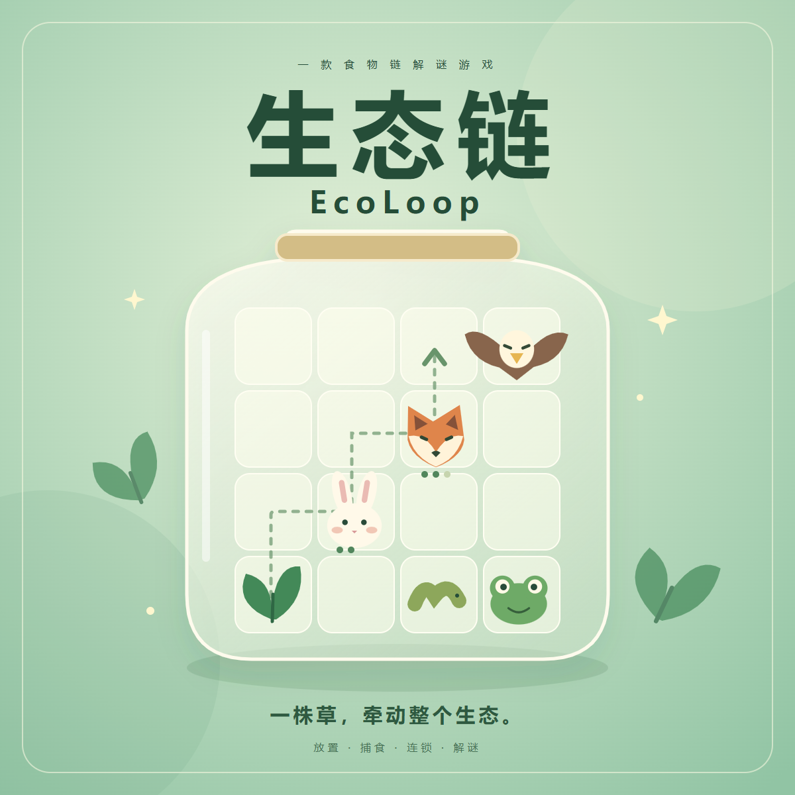
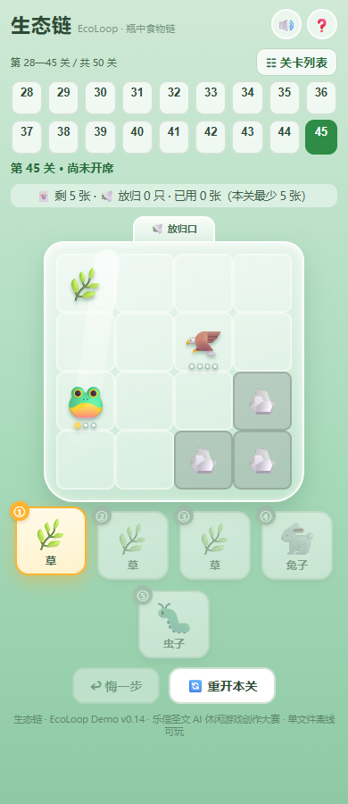

# 生态链 EcoLoop

**一株草，牵动整个生态。**

一款由我的生态主题想法出发，通过 AI 辅助编程、持续试玩反馈和多轮修改完成的食物链解谜游戏。作者：赵元恺。



## 从我的想法开始

我喜欢生物与生态，最初想做一款生态箱模拟经营游戏。考虑到关卡组织和实现范围，我将方向转向食物链与食物网：让玩家通过摆放食物，规划动物移动和捕食连锁，在解谜中观察因果关系。

在这个项目中，我负责提出创意与体验目标，通过试玩判断方案是否成立，并持续与 AI 讨论、调整和验收。AI 辅助实现代码、提出候选方案和编写验证工具；作品没有在运行时调用大模型。

## 游戏内容

- 50 个关卡，包含自由出牌与部分固定牌序题目。
- 点击手牌，再点击空格放置；动物自动捕食四邻食物，并移动到食物所在格。
- 一次放置可以触发多轮连锁；所有动物吃饱、被吃掉或离场即可过关。
- 支持撤销、重开、本地进度与规则教学。
- 单文件 HTML，现代浏览器可直接打开，无需安装或配置 API。

## 实际游戏画面



截图来自发布版实际运行，第45关“尚未开席”，不是概念图。

## 我的职责与 AI 的参与

| 环节 | 我的职责 | AI 辅助内容 |
|---|---|---|
| 创意与范围 | 提出生物生态主题，从生态箱经营转向食物链解谜，确定希望玩家获得的体验 | 讨论玩法可行性与实现方案 |
| 需求与取舍 | 表达玩法要求，判断是否符合预期，提出修改方向 | 将需求转为规则、界面与代码方案 |
| 试玩与迭代 | 亲自体验，围绕关卡重复、决策空间、规则理解提出反馈，与 AI 反复修改 | 分析反馈，生成候选盘面、修复实现并辅助核对 |
| 质量把关 | 区分“程序可解”与“实际好玩”，判断设计意图是否真的体现在玩法中 | 标准解回放、自动求解、基线比对与回归检查 |
| 作品表达 | 阐明创意动机、设计取舍和未实现目标，决定展示重点 | 辅助整理文档与交付资料 |

我不将 AI 辅助完成的代码描述为全部手写，也不把候选方案和测试脚本都归为个人独立实现。具体反馈案例见迭代复盘；案例依据作者指定的设计与迭代文档及本地验收记录整理，不作为原始聊天逐字引用。

## 使用的 AI 工具

| 开发阶段 | 工具组合 |
|---|---|
| 最初第 1—11 关原型 | deepseek Harness + glm5.3 |
| 后续扩展、重做与迭代 | Codex + Openai6.1sol |

工具名称按我的开发说明记录。封面 PNG/SVG 由 Codex + OpenAI 生成。阶段划分代表开发过程：早期关卡后来也经历过修改，不表示当前第 1—11 关完全保留最初实现。

## 代表性迭代

| 问题 | 迭代重点 | 收获 |
|---|---|---|
| 第 10 关开局自动捕食削弱选择 | 重排盘面，检查合法首步及其后续可解性 | 有动画不等于有有效决策 |
| 部分关卡只有外观差异 | 重做相似题目，重新组织资源分配与接菜位置 | 关卡差异要落实到玩家的选择 |
| 同类争食与选猎物容易混淆 | 明确两套优先级，补充规则教学与回归检查 | 需求必须表达为可验证的规则 |
| 第 46 关存在标准解以外的路线 | 核对合法替代解，修正设计解释 | 不能把标准解写成唯一策略 |
| 第 50 关扩展方案存在绕解 | 收敛为四步固定牌序，记录实现边界 | 用验证结果约束 AI 方案与作品宣传 |

第 50 关没有实现原计划中“两只动物最后同回合一起变饱”的目标；当前完成的是四步限时保留与不同归宿，不将原目标写成已实现功能。

## 试玩与阅读

下载后用浏览器打开 [游戏本体](index.html) 即可游玩。GitHub 的 HTML 文件预览页用于查看源码，不是试玩页。

- [设计思路](docs/design.md)
- [迭代优化过程](docs/iteration.md)
- [AI 协作与个人职责](docs/ai-workflow.md)
- [测试说明与结果](docs/testing.md)
- [素材来源与使用说明](docs/credits.md)
- [GitHub 发布说明](docs/publishing.md)

## 技术与验证

游戏使用 HTML、CSS、JavaScript；进度存储在当前浏览器本地。验证工具使用 Node.js，并直接抽取游戏引擎进行检查。

```sh
node tools/verify.mjs --levels 1,45,46,50
node tools/verify.mjs --full --baseline --selftest
```

自动验证用于检查规则案例、标准解、最优用牌数及模拟一致性；不能替代玩家盲测，也不能证明真人难度严格递增。

## 后续方向

通过玩家盲测记录理解时间、常见误判和撤销位置，继续检查相似关卡与替代路线。素材来源、授权边界和可复核测试记录见发布目录中的说明。
